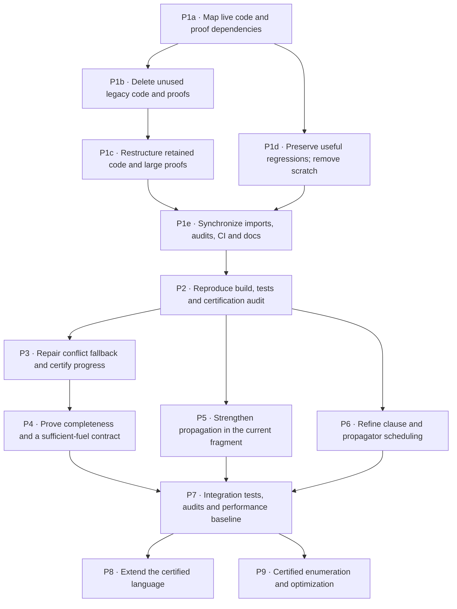

# Remaining work for the certified FlatZinc solver

Updated: 2026-10-05. This plan contains open work only. Completed tasks
and historical execution schedules have been removed; Git history retains
previous records.

The public solve path is `Main → Direct.solveCertified → LCG.solve`.
Source-level SAT and parameter-honest UNSAT theorems exist for the accepted
finite scalar integer/Boolean fragment. The remaining priorities are a
clean codebase, reproducible certification checks, and search progress.
Verdict soundness does not imply completeness or sufficient default fuel.

## Priority and dependency DAG

An arrow means the predecessor must be completed before the successor
is integrated. Tasks on separate branches can run in parallel, subject to
file ownership and available memory. P1 is the first task.

P1d can run alongside P1b/P1c after the dependency inventory. After P2,
P3, P5 and P6 are independent development branches; shared engine,
registration and proof changes must be integrated one at a time. P4
follows the repaired reference engine in P3; P6 must preserve that engine's
semantics and transfer its guarantees. P8 and P9 are later extensions,
not prerequisites for delivering the current certified solver.

## P1 — Restructure and clean the code first

Goal: retain one clear public solver path, the verified parser/checker,
and useful tests and proofs. Delete obsolete implementation and proof
files rather than keeping them as live archives.

- [ ] **P1a — Establish the live dependency inventory.** Trace executable,
  import and theorem dependencies from `Main.lean`, the library roots,
  every retained Lake test target, and `audits/certified_axioms.lean`.
  Inspect declaration uses as well as imports, including namespace and
  dot-notation calls. Classify files and declarations as production,
  useful reference/regression, or removable. Replace the stale inventory
  in `audits/dependency_inventory.md` with the current result.
- [ ] **P1b — Delete unused legacy code and proofs.** Review the retired
  Config/Solve/Fixpoint/Heuristic/Enum/Optimize/RevState/Learning/Restarts/
  Solver modules, the Tree family, and their dedicated legacy test files.
  Delete those without retained users. Remove obsolete compatibility
  paths, duplicate helpers, superseded proof scaffolding and unused
  theorems; update callers before removing files with useful shared
  declarations. Assess old singleton-only certification scaffolding
  against the current wide theorems and remove it where redundant.
  `Direct.Search`, `Direct.Correctness` and their proofs currently have
  theorem-level tests/audit users: keep a small useful reference or
  replace those uses before deletion. Preserve shared Domain/Extract/
  Propagators/Search/Emit declarations used by the certified path.
- [ ] **P1c — Restructure retained modules.** Separate shared foundations,
  compiler implementation/correspondence, LCG operations, family proof
  packages, run invariants and public certification composition. Split
  the large compiler proof modules at stable dependency boundaries,
  starting with `Direct/Proofs/Compile.lean` and `Exact.lean`; measure
  elaboration memory to guide the split. Narrow unnecessary imports and
  remove obsolete umbrella exports. Preserve theorem statements and
  public behavior; give each retained module a clear purpose and position
  in the dependency DAG. Update `code-structure.md` to actual imports.
- [ ] **P1d — Remove development debris.** Extract still-useful
  counterexamples from `tmp` into maintained regression tests or proof
  modules. Delete superseded candidates, probes and logs, then remove
  `tmp` and replace stale scratch references. Retain the active axiom
  audit; remove stale audit artifacts or consolidate their useful content.
  Do not delete build caches as part of source cleanup.
- [ ] **P1e — Finish cleanup integration.** Synchronize Lake targets,
  library exports, CI, theorem audit names, README and module comments.
  Remove stale singleton-only UNSAT claims, deleted-file references and
  historical task-number references. Check every deletion batch with
  scoped compilation; leave the final full validation to P2.

Completion gate: no unused legacy source retained without a stated
purpose, no missing imports or orphaned targets, no disposable scratch
folder, and a documented acyclic module structure. Existing useful
uncommitted implementation/proof work must survive the restructuring.

## Remaining tasks after cleanup

| Task | Depends on | Actions and completion gate |
| --- | --- | --- |
| **P2 · Restore a reproducible validation baseline** | P1e | Diagnose compiler-proof memory consumption and complete the aggregate build. Run all 15 retained test suites, proof-hole/user-axiom checks, the kernel axiom-profile audit, and CLI SAT/UNSAT/unknown/unsupported exit-code checks. Make CI fail on unexpected axioms, not merely print their profiles. Record commands and actual results. |
| **P3 · Repair fallback search progress** | P2 | Address nonempty unanalyzable conflicts, which currently retreat without learning. Evaluate the existing `FallbackRaw` entitlement lemma, implement a sound progress mechanism, and integrate its invariant transfers through the run proof and public certification. Account for the empty-conflict `trailBoolPinsOk` failure branch too. Prove progress rather than assuming that inserting a clause prevents repetition; add regressions for cycling cases. |
| **P4 · Specify and prove completeness/fuel guarantees** | P3 | Prove that accepted finite problems eventually yield SAT or UNSAT under the repaired reference engine, or explicitly state a narrower proved fragment. Establish a well-founded progress measure and sufficient fuel, or expose a justified fuel contract. Keep exhaustion as `unknown`; preserve parameter-honesty in source UNSAT. Validate both satisfiable and unsatisfiable multi-value cases. |
| **P5 · Strengthen propagation within the current fragment** | P2 | Add useful allDiff value-removal deductions using the existing `intNe` literals; assess remaining weak deductions in registered families. Each change needs sound deductions, valid explanation clauses, conflict entitlement, invariant compatibility and meaningful regression cases. Integrate registration/assembly changes serially. |
| **P6 · Refine propagation scheduling** | P2 | Replace full clause scans/propagator sweeps with watched literals and incremental wakeups where benchmarks justify it. Prove refinement of the reference semantics, including enqueueing, conflict detection and backjump repair; preserve or transfer P3/P4 guarantees. Measure runtime and memory against the reference implementation. |
| **P7 · Validate integrated changes** | P4, P5, P6 | Build the combined tree, run retained suites and CLI/checker regressions, audit public theorem axioms, and compare performance with P2. Update coverage and completeness claims to exactly what the proofs and checks establish. |
| **P8 · Extend the certified language** | P7 | Add unsupported scalar constraint shapes one family at a time, with compiler exactness/coverage, evaluator agreement, reason validity, propagator safety, conflict entitlement and source-level examples. Keep unsupported cases explicitly rejected until their complete proof package lands. Sets, floats and additional globals need separate scope decisions. |
| **P9 · Add certified enumeration/optimization** | P7 | Define result contracts and source-level proofs for complete enumeration and objective optimality before restoring these commands. Give them dedicated tests and documented output guarantees; keep rendering correctness separate from solver correctness. |

## Parallel execution boundaries

| Stage | Work that can proceed in parallel | Work to serialize |
| --- | --- | --- |
| Cleanup inventory | Read-only dependency, test and theorem-use inventory | Agree on the retained roots and deletion list before editing |
| Cleanup implementation | P1d regression preservation versus P1b/P1c code cleanup; disjoint module restructuring after boundaries are fixed | Deletion before dependent restructuring; shared imports, library roots and P1e integration |
| Solver development after P2 | P3 engine progress; P5 family packages; P6 scheduler design/refinement | Changes to shared Engine/Propagate modules, registration, run invariants and public certification |
| Completeness | P4 on the repaired reference engine; P5 packages and P6 refinement on separate modules | Transfer progress/completeness guarantees to the refined engine |
| Later extensions | P8 family packages and P9 result-contract work | Shared compiler/API changes and final integration |

One writer owns each shared file during integration. Use disjoint modules
or isolated checkouts for concurrent work; the DAG describes possible
parallelism, not a requirement to run all branches simultaneously. Use
one substantial Lean build at a time until memory usage is understood.

## Validation constraint carried into P1/P2

The latest attempted aggregate build was killed with exit code 137 in
`solver.Direct.Proofs.Compile` after 124 seconds; the cgroup reported an
OOM kill. The axiom audit could not run because that module's `.olean`
was missing. The 89 propagator tests passed, and a static scan found no
proof-hole tokens or user axiom declarations in 115 Lean files. This is
not a successful repository-wide certification run.
