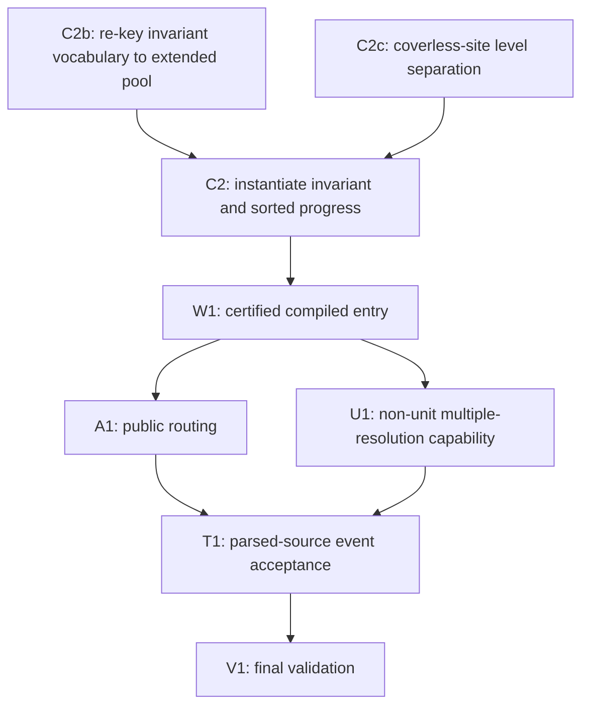

# Remaining work: certified public first-UIP LCG

Updated: 2026-10-12. This is the sole continuation plan, coordinator prompt,
worker handoff and current status record. Do not create separate planning files.
README, architecture and interface files remain reference documentation;
actual Lean signatures and public call sites are authoritative.

Repository modules now live under LeanFzn.Syntax/Parser/Semantics/Checker,
LeanFzn.Compiler, LeanFzn.Solver.Core/Propagation/Chronological/UIP/Reference,
and LeanFzn.Integration/Cli. Internal imports are component-specific. Existing
CLI behavior is chronological; restructuring does not activate UIP. Old
solver.* imports and LCG/Direct namespaces are removed. Architecture validation
is `python3 audits/check_module_boundaries.py`; aggregate validation uses
`lake build LeanFzn Tests leanfzn` plus every registered test executable.

## Current checkpoint and scope

The unit-kit invariant, restoration, log and consume assemblies compile.
The concrete invariant package in SupportedInstance still exposes two genuine
residuals: coverless-site level separation (`hsepF`) and original-pool trail
vocabulary (`hv`). Extended-pool producers/rank proofs exist, but the remaining
original-pool consumers must be re-keyed before those proofs discharge `hv`.

Last independent verification after restructuring: explicit aggregate 486 jobs
exit 0; all 21 registered test executables exit 0; axiom audit 323/323
allowlist-only, no sorryAx; transitive component boundaries and cycles pass.
CLI smoke outputs/exit classes and checked SAT witnesses match the recorded
chronological baseline. This is full registered-suite validation of the refactor,
not public first-UIP acceptance. Revalidate after edits.
Public solving still uses `Search.solveWithStats → analyzedSolve`.

Target: computable certified public first-UIP solving for an explicit finite
int/bool satisfaction fragment, preserving accepted source models through the
proved fallback policy and keeping the named chronological reference. Language
expansion, optimization and tuning are outside scope. Non-unit multiple-resolution
capability remains unmet; unit-only activation must not be advertised as closing
that part of the goal.

## Remaining DAG

Ready: C2b and C2c. Their completion releases C2 and the concrete entry. Do not
redo the completed restoration/log/consume or extended-pool proof assemblies.

## Assignable tasks and acceptance

Proof paths are relative to `LeanFzn/Solver/UIP/Proofs/`. A compiled conditional wrapper
is not a concrete producer. Acceptance requires all row conditions and explicit
review of hypotheses; no holes, custom axioms or circular assumptions.

| ID | Depends on | Deliverable and acceptance conditions |
| --- | --- | --- |
| C2b | None | Replace remaining `hv : BranchTrailVocabulary orig ...` consumers with `BranchTrailVocabularyAt (litPoolExt orig dcs) ...`. Own isolated extended-pool slot-range and producer adapters; coordinate HdeadCkpt/SupportedInstance edits. Prove slot-range facts for the actual pool and instantiate the existing extended run vocabulary. Eliminate dependence on refutable original-pool UnitEmissionVocabulary. No assumed original/extended pool equivalence or new semantic vocabulary gate. Compile all invariant/progress consumers. |
| C2c | None | Discharge the exact `hsepF` family of the `_or_coverless` SupportedInstance entry. Own FreshCoverless and isolated site lemmas; coordinate runtime changes. Remaining case: empty-prefix canonical consume, level-0 propagations, then a decision pushing a level-0 checkpoint. Reuse canonical-trail separation and unit-kit target-0 facts. Prove separation along the actual run, or preserve a reachable counterexample and implement a sound freshness/snapshot repair. Do not assume universal inhabitedness or weaken the required loose survivor bound. |
| C2 | C2b, C2c | Instantiate the existing unit-kit invariant package without `hsepF`/`hv` caller premises, using the proved inhabited-or-coverless classification. Feed concrete extended-pool alignment, novelty/rank and site facts into SupportedPhaseRun/SupportedCertifiedRun. Produce usable SupportedPhasePremises and terminal/dead/root facts from legitimate problem hypotheses; no assumed progress or per-state semantic invariant. Include a non-vacuous initialized instance. |
| W1 | C2 | Export a computable compiled SAT/UNSAT/totality entry from compiler/model hypotheses only. Instantiate existing whole-run transfers and FallbackPolicy for uncovered families, preserving source acceptance and aux/parameter semantics. No exposed restoration, deadness, log, vocabulary, invariant or progress conclusion. Execute compiled SAT and UNSAT inputs and check witnesses. |
| A1 | W1 | Wire Search/Certified/direct CLI through the concrete certified entry and explicit fallback policy. Preserve source theorem meanings and named chronological reference. Verify the executable-to-proof call graph, compile CLI and show that supported parsed input reaches the intended scheduler. |
| U1 | W1 | Close the retained non-unit multiple-resolution obligation. Build on the concrete unit route; specify and implement the additional explanation/learning contracts needed for a meaningful non-unit fragment, retaining counterexamples to older evidence assumptions. Produce concrete certification for that route and update the routing predicate only after proofs compile. Source acceptance must remain preserved through proved fallback. This is an explicit remaining capability task, not a claim that fallback provides first-UIP behavior. |
| T1 | A1, U1 | Apply event predicates to genuine parsed-source public runs: multiple resolutions, skipped-level jump, assertion and subsequent propagation. Bypassing analysis must fail acceptance. Check oracle verdicts/witnesses and pending/empty/root/sparse/repeated-learning regressions. Unit-only results may be reported as an intermediate milestone; constructed-state events or chronological fallback cannot satisfy final multiple-resolution acceptance. |
| V1 | T1 | Build explicit aggregate and run every registered suite with preserved exit statuses/timeouts. Audit the instantiated public source/invariant/progress chains and scan code for holes/custom axioms. Record actual public events, supported scope/fallbacks and limitations; reconcile this plan and applicable reference documentation. |

## Execution priority and completion

Assign C2b and C2c to separate owners. An integration owner reserves
SupportedInstance, shared runtime/gate consumers and umbrella/audits. Once their
producers compile, integrate C2, then W1/A1. U1 is a substantive capability
extension within the final goal and may need smaller proof tasks after its
interfaces are fixed; it must remain visibly open until certified.

Complete the unit-kit intermediate milestone after C2/W1/A1 with parsed-source
unit evidence. Complete the full goal only after U1/T1/V1 as well. Do not declare
the goal complete merely because the current conditional tree is coherent.

## Coordinator prompt and round protocol

When asked to execute this plan, act as coordinator and use worker agents within
available slots, leaving one slot for the coordinator. This section is a future
execution prompt; maintaining the document does not itself start proof workers.
Preserve unrelated working-tree edits. No commit, push or publication unless
separately authorized. Read applicable AGENTS.md, this plan, relevant reference
entries and Lean/Lake configuration once; inspect actual signatures before work.
Use lean-development and lean-proof-coordinator skills when applicable.

Follow the DAG. Assign one small objective and exclusive files per worker.
Shared runtime, SupportedArms/SupportedDead, umbrella, target and audit edits
have one integration owner. Workers request shared changes with an exact diff;
no unallocated subdelegation. Inspect CPU/RAM and active builds, preserve caches,
and use one substantial build at a time.

Every round is at most 10 minutes wall-clock. Record start/deadline, ask for a
checkpoint around minute 8 and a stopped-editing handoff by minute 10. Check
with waits no longer than 60 seconds. Interrupt a nonreporting worker at the
deadline and settle files/jobs/ownership before reassignment; do not kill
unrelated jobs. A round ending does not complete the objective. Continue, split,
repair or reassign after coordinator review. If repeated attempts stall,
reassess the statement or seek a reachable counterexample.

Assignment template: task/round; precise declaration or repair; accepted
prerequisites and residual owners; exclusive/shared files; acceptance conditions;
focused validation command; start, minute-8 checkpoint and minute-10 stop/report.
Reports include changed files, exported signatures, fulfilled/unfulfilled
conditions, exact remaining hypotheses, commands/exit codes, running jobs,
errors/counterexamples and a recommended next step. Status is
COMPLETE-CANDIDATE, PARTIAL or BLOCKED. Coordinator decides ACCEPT, CONTINUE,
SPLIT/REASSIGN, REPAIR or BLOCK/REPLAN after checking diffs and call sites.
Only ACCEPT releases dependencies; never label partial work accepted.

Record current ownership, accepted results and residuals in this plan. Replace
superseded status instead of appending long round histories. Recover crashed
workers from files and compiler feedback. Keep user updates concise. Continue
until the completion gate or an explicit stop/execution limit; if stopping
unfinished, leave exact resume instructions here without claiming completion.

## Worker ownership and handoffs

- C2b: ExtendedPoolProducers/ExtendedPoolRank plus isolated slot-range adapters.
  Inspect every remaining original-pool `hv` use. Request exact shared-consumer
  edits from integration owner. Handoff includes exported slot-range/vocabulary
  statements and every consumer converted.
- C2c: FreshCoverless plus isolated coverless-site lemmas. State the exact
  SupportedInstance `hsepF` shape before proving it; checkpoint claims against
  the concrete empty-prefix/level-0 case. Handoff includes checked proof or
  reachable counterexample and the proposed semantics-preserving repair.
- Integration: SupportedInstance/SupportedPhaseRun/SupportedCertifiedRun,
  shared gates/runtime, registration and audits. Reuse existing AnalysisEntail,
  SupportedLogSites, ConsumeRun and CheckpointPrefix results; do not recreate
  their dispatcher inductions. Review residual dependencies before integration.
- Downstream: assign C2/W1 and public routing only after their prerequisite
  interfaces are accepted. Keep U1 visible in the capability matrix and split
  it into exact obligations when its explanation interface is chosen.

## Validation and semantic guardrails

Capture the command's exit status before displaying its log. Build pipelines,
stale binaries after failed builds, timeouts and missing profiles are not passes.
Run focused checks within rounds; final V1 runs every registered suite and fresh
instantiated theorem/dependency audits, code-aware hole/custom-axiom scanning
and genuine public event checks. Keep module/reference docs current when imports
or semantics change, but keep continuation instructions only here.

Retain counterexamples and preserve source acceptance, named chronological
reference, bool/int typing and auxiliary-slot/parameter semantics. Never replace
live-sibling preservation with level-only dropping, infer ancestor exclusion from
one dead descendant, assume universal frame inhabitedness, fabricate counters,
use arbitrary verdict fuel, or weaken statements silently. An axiom-clean
implication with impossible premises is not concrete certification. Treat old
historical task aliases/counts as stale; actual declarations are authoritative.
