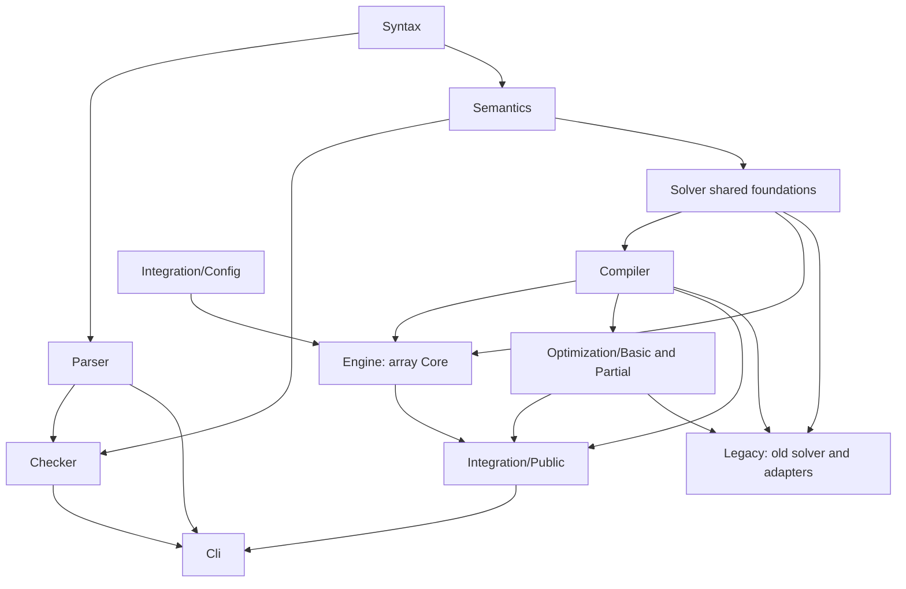

# LeanFzn code and proof structure

Updated 2026-11-04 for the Core-only public API. Actual imports and
`lakefile.toml` are authoritative. [README.md](README.md) describes commands;
[PLAN.md](PLAN.md) records the active work and historical measurements.

## Public dependency graph



The public CLI, Core engine, shared foundations and `Integration/` have no
imports of `LeanFzn.Legacy`. `LeanFzn.lean` and `Integration.lean` expose the
Core-only API. The boundary audit verifies these properties transitively.
It masks nested comments and strings, so an import immediately after `-/`
cannot evade the check. It also rejects missing project imports and cycles.

**Core engine** means `Engine/`. **Shared foundations** means `Solver/Core/`
and the retained `Solver/Propagation/` modules. Those foundations contain
problems, finite domains, constraint/literal semantics and proof infrastructure;
they are not a second public engine. Historical executable helper definitions
still appear in some shared reference/proof modules and need further extraction
before their corresponding old definitions can be deleted. The public drivers
never call the old search implementations.

## Reading paths

| Task | Start here |
| --- | --- |
| Parsing | `Syntax/AST` → `Parser/{Lexer,Grammar,Parser}` → `Parser/Proofs/` |
| Solution acceptance | `Semantics/{Model,Evaluation}` → `Checker/Runtime/` → `Checker/Proofs/` |
| Public solve | `Cli/Main` → `Integration/Public/Driver` → `Public/Solve` or `Public/{Optimize,Seed}` |
| Core runtime | `Engine/Types` → `Dom`, `Lit`, `Trail` → `Prop`, `Clauses`, `Queue/Run` → `Analyze`, `Reduce`, `Search` |
| Source correspondence | `Compiler/{Domain,Extract,Compile,Normalize,SetIn}` → `Compiler/Proofs/{Exact,Normalize,SetIn,Objective}` |
| Generic optimization | `Integration/Optimization/Basic` → `Optimization/Partial` → `Public/Optimize` |
| Historical solver | Explicit `Legacy/Solver/{UIP,Chronological}` and `Legacy/Integration/` imports |

Paths are relative to `LeanFzn/` and omit `.lean`.

## Core-only public APIs

```text
Integration/
  Config/         Types, Validate, Parse, Annotations
  Emit/           Basic, Model
  Optimization/   Basic, Partial
  Public/         Solve, Optimize, Seed, Driver
```

Declarations for the new public solver live in `LeanFzn.Core`. Shared generic
optimization, rendering and configuration declarations remain in
`LeanFzn.Integration`. Old solver declarations keep their original namespaces
but require explicit `LeanFzn.Legacy...` imports. This preserves their theorem
statements without making the old execution contract part of the public API.

| Module | Contract |
| --- | --- |
| `Public/Solve` | `solveCompiled` maps Core `gaveUp` to `SearchResult.unknown`. `solveModel` compiles and transfers SAT/UNSAT to source stores. The stats twin performs the same single Core run. |
| `Public/Optimize` | Raw Core SAT/UNSAT is sound; give-up becomes an incomplete round. Linear optimization reuses generic branch-and-bound and exact streaming proofs. |
| `Public/Seed` | Carries the certified clause database across stronger bounds using Engine.Incremental. Its invariant and streaming correspondence cover incomplete runs; no legacy fallback or unconditional completion theorem is used. |
| `Public/Driver` | Validates Core-only options, prints valid incumbents immediately, uses exit 4 for unknown/incomplete, and emits terminal markers only on certified completion. |
| `Config/Parse` | `parseCoreSolveFlags` disables implicit legacy routing and rejects the kernel engine. The older compatibility parser is used only by explicit legacy APIs. |
| `Emit/Model` | Source-store rendering extracted from old source solving, with no backend dependency. |

`Solver/Core` still defines the shared compact `Dom`; Engine defines its own
array-oriented `DomC`. List-based mathematical enumeration and front-end lists
are retained. Core-only execution does not require rewriting those mathematical
interfaces as arrays.

## Certification and incompleteness

Every Core clause carries an erased `Entailed` proof through `EClause`.
Propagators and resolution construct certified clauses; a satisfying assignment
is checked by `fitsB && accepts`; UNSAT follows from an entailed empty clause.
`Engine/Search.coreSolve_sat` and `coreSolve_unsat` remain unchanged.

The public `solveCompiled_sat`/`_unsat` and
`solveModel_sat_correct`/`_unsat_correct` transport those claims to source
models. Core's fuel-bounded search always returns computationally, but may
return `gaveUp`. The public API intentionally makes no claim that every accepted
finite input receives SAT/UNSAT. Wide sparse domains are one current give-up
case; internal analysis failures are another.

`Optimization/Basic` preserves the existing `CertSolver`, generic loops,
termination measure, solution/optimality theorems and streaming specifications.
The chronological instance has moved to
`Legacy/Integration/Optimization/Chronological`. Basic now imports compiler
correspondence and shared domain lemmas directly, rather than old source solving.

`Optimization/Partial` introduces `PartialCertSolver`: SAT/UNSAT soundness
without a promise to decide every run. Its adapter uses the existing generic
interface's false completeness gate explicitly. That gate is a proof-side
optional guarantee, not a runtime admission test: the optimizer runs, retains
incumbents when a round fails, and proves optimality/UNSAT only when complete.
No old generic theorem has been weakened. The old unconditional completion
proofs remain attached to the preserved legacy definitions.

## Engine code and proofs

| Modules | Responsibility |
| --- | --- |
| `Types`, `Dom`, `Proofs/Dom` | State, literals, `DomC` operations and their domain laws |
| `Lit`, `Trail`, `Clauses` | Denotation, entailment/resolution, assignments, restoration and watched clauses |
| `Prop`, `Props/` | Generic and specialized certified propagators |
| `Queue/{Types,Worklist,Apply,Run}` | Invariant specifications, event registration, pending prunings and fixpoint execution |
| `Proofs/Queue/{History,Invariants,Bookkeeping,Soundness}` | Preservation and propagation soundness |
| `Analyze`, `Reduce`, `Search` | Conflict analysis, clause reduction, variable/value policies, restarts and search |
| `Incremental` | Certified database transport and seeded Core search across objective bounds |

Order propagators have `Bounds`, `Compare`, `Bridge`, `ReifiedReasons` and
`Reified` modules. Extended linear propagators have `Bounds`, `Plans`,
`Reified` and `Contracts`. Constructor prerequisites remain near the code that
needs them. Separating every entailment lemma into downstream proof files would
introduce backwards dependencies.

Parser, Checker and Compiler have explicit proof trees. Checker runtime and
correctness modules have separate umbrella imports. Semantics, some Engine
modules and the new seeded optimizer still mix executable definitions and
proofs; absence of a `Proofs/` folder does not imply absence of verification.

## Preserved legacy layer

`Legacy/` contains the old UIP and chronological implementations, their
exclusive propagation machinery, reference strategies, integration adapters,
old option drivers and historical Core-to-kernel fallback wrappers. The move
preserves mathematical declaration names and certified theorem statements.
Old imports were migrated explicitly; there are no active compatibility shims
outside Legacy that pull the old solver into the production graph.

Build the historical implementation with `lake build LeanFzn.Legacy`. The old
`LeanFzn.Solver.UIP` and `LeanFzn.Solver.Chronological` Lake target names remain
explicit development build aliases for the relocated modules. Existing legacy
regression tests and theorem-profile queries now import the relocated modules.
`tests_core_spike --engine=kernel` is a development comparison tool, not public
CLI routing.

Removing Legacy entirely is later work: identify shared proof/reference
helpers still needed by compiler/propagator correctness, preserve useful test
oracles, and then delete old algorithms and their historical theorems together.
No list-based completeness fallback is used to hide missing Core coverage now.

## Validation and maintenance

`tests_core_only` checks Core defaults, option rejection, SAT/UNSAT,
unknown on sparse domains/zero fuel, linear and seeded min/max, clause reuse,
independent checker acceptance and retention of a streamed incumbent when a
later round is incomplete. `audits/test_core_only_cli.py` checks exit codes,
markers, statistics and witness text. `Tests/Architecture/test_boundaries.py`
regresses nested-comment import scanning, strings, missing modules and cycles.

The full gate builds public and Legacy code explicitly, runs the registered
executables and both regression suites, audits theorem axioms and imports,
compares Core against the explicit legacy development oracle, fuzzes 3,000
instances and runs the short performance suite. The old 2026-11-03 gate and
PLAN benchmark tables describe the earlier combined route. They do not measure
Core-only decision coverage. Record any new measurements with their own source
snapshot and budget.

Benchmark reports distinguish completed mathematical agreement from explicit
migration allowances. The known UNSAT nonunit-jump fixture currently returns
unknown; its allowlist entry does not change its expected truth. Unknown and
incomplete-with-incumbent (exit 4) are separate outcomes, while false terminal
markers are errors. The quick gate requires every case either to complete
correctly or match its explicit incomplete allowance, with every witness checked.

The Core-only acceptance gate passed on 2026-11-04 (`tmp/gates/core-only-accept-20261104T081225Z/`):
52 runnable executables; a 52-instance battery and 45-instance cross-check;
all 3,331 theorem axiom profiles; Core/legacy differential checks; 453 modules
with no import cycles or production Legacy imports; 3,000 harness fuzz instances
with zero wrong/bound/witness failures; five CLI regression tests and ten import/
outcome regression tests. The quick suite reports 10 completed cases plus the
one explicitly allowed unknown, with all eight witness checks accepted.
