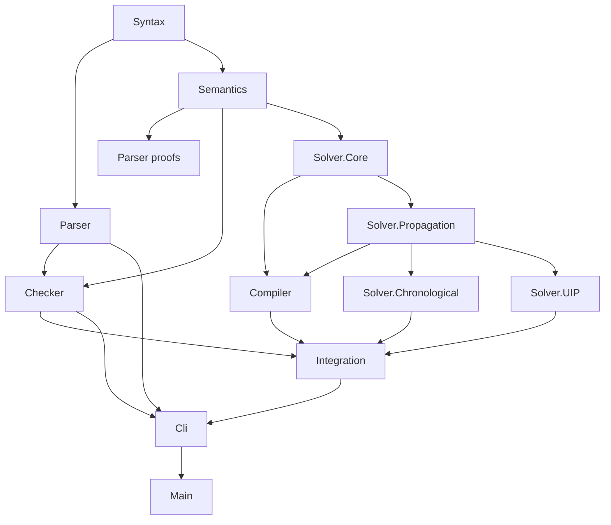

# LeanFzn component dependencies

Current architecture, reconciled with source imports on 2026-10-17. This document
explains module responsibilities and proof dependencies; it is not a chronological
work log. Actual imports and `lakefile.toml` remain authoritative. Existing work
is tracked in [PLAN.md](PLAN.md); optional performance work and agent partitions
are in [PLAN_PERFORMANCE.md](PLAN_PERFORMANCE.md).

## Component boundaries

Arrows indicate dependency → consumer. This is a component overview, not every
individual import.



| Component | Responsibility and boundary |
| --- | --- |
| Syntax | AST types and their owning extension methods. |
| Parser | Lexer, declarative grammar, parser, pretty printer, and recognition proofs. |
| Semantics | Stores, model meanings, standard/global predicates and value equality; independent of Checker, Compiler and search strategies. |
| Checker | Solution syntax, store completion, well-formedness and certified checking, including equivalent executable fast entries; independent of Compiler and search. |
| Solver.Core | Problems, assignments and shared types. `Domain` is currently `List Value`. |
| Solver.Propagation | Constraints, clauses, trails, frames, filtering, explanations, propagators and reusable proof contracts; independent of either public search strategy. |
| Compiler | Scalar compilation, array normalization, auxiliary shapes, objectives, seed clauses and source correspondence; may import shared Propagation definitions but neither search strategy nor Checker. |
| Solver.Chronological | Certified finite-frontier search, chronological backtracking and learned-clause pruning; supplies fallback. |
| Solver.UIP | First-UIP scheduler, conflict analysis integration, backjumping, restoration, progress ranks and whole-run certification; does not import Chronological. |
| Solver.Reference | Exhaustive/diagnostic search and supporting proofs; independent of public strategy implementations. |
| Integration | Combines compiler exactness, certified search, fallback, objective drivers and output reconstruction; may import both strategies and Checker. |
| Cli / Main | Parsing/checking/solving I/O; `Main.lean` delegates to the CLI. |

Each active component has a Lake library target and root module. `LeanFzn.lean`
is an optional full-stack umbrella; internal modules use narrower imports.
`Tests` is a separate library with component tests and measurement modules.
The lowercase `solver/` directory is a legacy implementation, absent from current
Lake library targets. Active `LeanFzn` modules must not import it.

`python3 audits/check_module_boundaries.py` checks forbidden transitive imports,
umbrella imports, legacy solver imports and cycles. It currently finds 307
`LeanFzn` modules; this count excludes Tests and the legacy tree.

## Public routes and optimization

The current satisfaction route is:

```text
Cli.Main.runSolve
  -> Integration.CertifiedSolve.solveCertified
     -> Compiler.Normalize.compileModelFull
     -> gateOk
     -> Integration.LcgHeur.solveCompiledLcgHeur
        -> lcgRouteGateMixed
           true: activity-ordered presentation -> Lcg.lcgRun -> scheduled UIP kernel
           false: certified Chronological.solve
     -> compiled assignment -> source store -> emitted solution
```

`gateOk` rejects unsupported search spaces before running the compiled route.
The mixed route has additional shape/range/typing/propagation gates; family-gate
acceptance alone does not establish that a model takes the LCG branch.
`solveCompiledLcgMixed` and `solveCompiledLcg` remain certified compiled entries;
the public source entry now uses the heuristic wrapper.

`LcgHeur.lean` imports `Lcg.lean`. Its static value scores count constraint
constants and seed-clause pin occurrences. Domain-list permutations transfer
membership, acceptance and verdict proofs back to the original problem. This
changes value order, not variable order. Frames still select variables through
a chosen assignment prefix; dynamic activity and restarts are not implemented.

The current optimization CLI calls `Optimize.optimizeStream LcgOptimize.lcgSolver`.
`lcgSolver` uses the same heuristic compiled verdict. Improving solutions are
printed and flushed immediately; completion is certified through infeasibility
of the strict improving bound. This CLI path does not reuse learned clauses
between solves.

A separate seeded path exists in `LcgSeed.lean` and `OptimizeSeed.lean`, with
`UIP/Proofs/LcgPhaseRunDb.lean` supplying seeded-run facts. It supports clause
reuse across tighter bounds and has integration tests, but is not the driver
called by `Cli.Main.runOptimize`.

Direct integration dependencies:

| Module | Principal direct dependencies / role |
| --- | --- |
| `Integration/Lcg.lean` | Compiler CompileCore/SeedClauses, Chronological search proofs, integer/mixed compiled kits, scheduled kernel and terminal/seed-clause proofs. |
| `Integration/LcgHeur.lean` | Lcg; presentation permutations and heuristic compiled entry. |
| `Integration/CertifiedSolve.lean` | Compiler Exact/Normalize, Certified, Chronological, Lcg/LcgHeur, Propagators, Checker.Check and Emit; source SAT/UNSAT/totality composition. |
| `Integration/Optimize.lean` | CertifiedSolve and compiler objective extraction/proofs; generic certified branch-and-bound and streaming. |
| `Integration/LcgOptimize.lean` | Optimize, Lcg and LcgHeur; certified solver interface used by the CLI. |
| `Integration/OptimizeSeed.lean` | Optimize, canonical clause and supported database proofs; generic seeded driver. |
| `Integration/LcgSeed.lean` | LcgOptimize, OptimizeSeed and LcgPhaseRunDb; seeded LCG instantiation and monotone-bound reuse. |

## Compiler and propagation foundations

`Compiler/Normalize.lean` inlines supported literal parameter arrays and aliases
of scalar variables before `compileModel`. `Proofs/Normalize.lean` transports
source satisfaction. `Compiler/Compile.lean` expands supported literal shapes
through fresh pinned auxiliary slots; `CompileAux*` and `Proofs/Exact.lean` prove
correspondence. This includes literal operands in scalar reified constraints
and supported binary min/max shapes. `Compiler/Objective.lean` extracts a plain
integer-slot objective; its proof module supports certified optimization.

`Compiler/SeedClauses.lean` translates `bool_clause` constraints to original
clauses. `UIP/Proofs/LcgSeedClauses.lean` proves canonicality/alignment/entailment
used by compiled kits. Compiled original clauses are therefore not always empty.

`Propagation/Proofs/Propagators.lean` owns `propagatorOfProved` registration and
its inversion/consumer facts. Dedicated propagators include:

- Comparisons, constants, addition, linear equality/inequality/disequality.
- Binary min/max, multiplication, abs/div/mod, and n-ary `propMinGen`/`propMaxGen`.
- Scalar and linear reified families. Directional strength varies: several
  pinned-false branches are conflict-only; linear ≤ also has bounds-to-Boolean
  inference with explicit range/arity guards.
- Boolean not/and/or and `propAllDiffLCG`, including fixed-value elimination
  alongside pigeonhole conflict detection.

Important family proof leaves include `Proofs/Fam/Lin.lean`, `Arith.lean`,
`Times.lean`, `AllDiff.lean`, `Reif.lean` and `MinGen.lean`. Reif imports Lin,
Bool and Propagate; MinGen imports Lin; Times uses ConstFamilies, Theory,
Propagate and Encoding. Keep runtime explanations and their semantic proofs
consistent when changing these modules.

There are three distinct enforcement mechanisms:

1. Dedicated explained propagators for the families above.
2. Generic `propCheck` for residual literal-operand `minPair`/`maxPair` forms;
   all-slot pairs use binary min/max propagation. The residual forms are not
   emitted by the current compiler. `Proofs/PropCheck.lean` provides the shared
   checker and generic facts; `UIP/Proofs/LcgPropCheck.lean` supplies UIP contracts.
3. No registered dedicated propagator for `boolClauseSlot`, `arrayBoolAndSlot`,
   `bool2intSlot`, `boolEqSlot`, and the three element families. They retain
   leaf enforcement; `bool_clause` additionally propagates through its seeded DB.

`lcgFamB` in `UIP/Proofs/LcgFamiliesRun.lean` accepts every constructor. This
must not be confused with dedicated pruning coverage or with the full route gate.
`dcSlots`/`dcSlotsFull` supply slot lists for gate checks. `domPruningOkB` includes
reified operand range/arity and all_different conditions; extraction lemmas and
explicit internal hypotheses carry them through reason/fallback contracts.
Public source proofs compose the necessary compiler and runtime gate evidence.

## UIP proof dependency branches

The implementation has separate proof branches that converge at the compiled
kit and public terminal proofs:

| Branch | Modules and purpose |
| --- | --- |
| Propagator contracts | `LcgFamilies*`, `LcgFamiliesRun`, `LcgEmissionTyped`, `LcgPropContract`, `LcgCanonicalFamilies`, `LcgNoBoolEmit`: semantic reasons, typing, canonicality and allowed atoms. |
| Integer semantic run | `LcgRunInvariant*`, `LcgRunState`, `LcgRunStep`, `LcgKitFinal`: initialization, preservation and integer kit assembly. |
| Mixed semantic run | `LcgBooleanPins`, `LcgBooleanFalsity`, `LcgMixedEvents`, `LcgMixedGood`, `LcgMixedCore`, `LcgMixedConflict`, `LcgMixedFrameRun`, `LcgMixedRunState`, `LcgMixedJump`, `LcgMixedRunDrop`, `LcgMixedRunStep`: mixed-shape semantics, frame/checkpoint provenance, conflicts and joint run induction. |
| Canonical vocabulary | `ClampPool`, `LcgCanonicalClauses`, `LcgCanonicalRun`, `LcgCanonicalScheduler`, extended-pool/rank proofs: canonical analyses, database preservation and finite progress vocabulary. |
| Coverage / terminal | `LcgLiveCoverage`, `LcgMixedLiveCoverage`, `LcgPhaseTerminal`, `LcgMixedPhaseTerminal`: frontier coverage and SAT/UNSAT transfer. |
| Executable gates | `LcgCompiledKit`, `LcgMixedCompiledKit`: executable checks construct internal kits; the latter supplies proved-equivalent `mixedKitGateFastB`. |
| Whole-run assembly | `LcgMixedKitFinal` imports LcgMixedRunStep, LcgRunInvariantFinal and LcgKitFinal; `LcgPhaseKernel` and scheduled adapters connect the runtime to terminal proofs. |

`LcgRunInvariantAbsentShape` preserves a structural counterexample for an
abstract empty-Boolean configuration. Historical local strengthening questions
must not be presented as missing public proof premises: follow the actual kit
producers and terminal composition to determine what a public result assumes.

## Runtime optimizations and reference implementations

- `Propagation/DbScanIndex.lean` imports Pruning and ClausePropagation. It builds
  a per-scan domain array and classifies clauses without allocating the full
  remaining-literal list. `scanDatabaseFast_eq` is unconditional equality with
  the reference scan, not a watched-literal implementation.
- `Propagation/ScheduledPropagation.lean` imports Pruning, Propagate, DbScanIndex
  and Semantics.ValueEquality. Watch projections/stamps permit justified reuse;
  empty watch footprints do not supply a general incremental dependency index.
  `ScheduledFamilies.lean` provides concrete locality facts.
- `UIP/Proofs/SchedulerStepSched.lean` bridges scheduled steps to the reference
  scheduler; `LcgPhaseKernelSched.lean` imports that bridge and LcgPhaseKernel.
  `Integration/Lcg.lean` uses this scheduled kernel for `lcgRun`.
- `LcgMixedCompiledKit.lean` imports LcgMixedGood, LcgEmissionTyped,
  LcgPropContract and Semantics.StdLib. `mixedKitGateFastB_eq` preserves the
  original mixed-gate result while avoiding the expensive duplicate check.

Current costs still include eager list domains, learned DB scanning, and
positional decisions. Future event queues, watches, compact domains, deletion
and restarts need the distinct proof tracks described in PLAN_PERFORMANCE.md.

## Tests, audits and integration discipline

Tests are grouped into Parser, Checker, Semantics, Propagation, Chronological,
UIP, Integration and E1 measurements. `lakefile.toml` is the executable inventory;
README gives explicit rebuild/run commands. In particular:

- Public routing: `Tests/Integration/PublicLcg*` and `HeurLcg*`.
- Optimization: `Optimize`, `OptimizeBnB`, `LcgOptimize`; seeded/unseeded paths
  may visit different improving sequences while proving the same optimum.
- Runtime oracle/fuzzing: `Tests/UIP/LcgHarness*`, kernel/prototype fixtures.
- Measurements: `Tests/E1/{PhaseTiming,ScanCounts,SchedCounts,DbScanCounts,P3bGateTiming}`.
- File-driven compiler coverage: `Tests/Integration/ChallengeScan.lean`.
- `audits/certified_axioms.lean` and `run_axiom_audit.sh`: selected theorem axiom
  profiles with fail-closed allowlist validation. `audits/README.md` documents
  retained tools, historical measurements and the removal of obsolete artifacts.

Keep Propagation below both strategies, and put source/compiler composition in
Integration. Registration, common obligation assemblies, scheduler state/ranks,
compiler exactness and public routing are shared integration surfaces: assign one
owner while agents work on independent proof leaves or family modules. Use Lean
MCP diagnostics/goals first, then focused consumer builds; serialize heavy builds.

The recorded full 2026-10-17 gate reports 458 solver tests, 1040 axiom profiles,
307 modules, all runnable executables passing, a 50-case battery and 3,000 fuzz
instances without wrong/bound/witness failures. It also records 31 `c-sem`
tracker observations requiring the follow-up described in the performance plan.
These are historical validation results, not fresh checks of arbitrary later edits.
