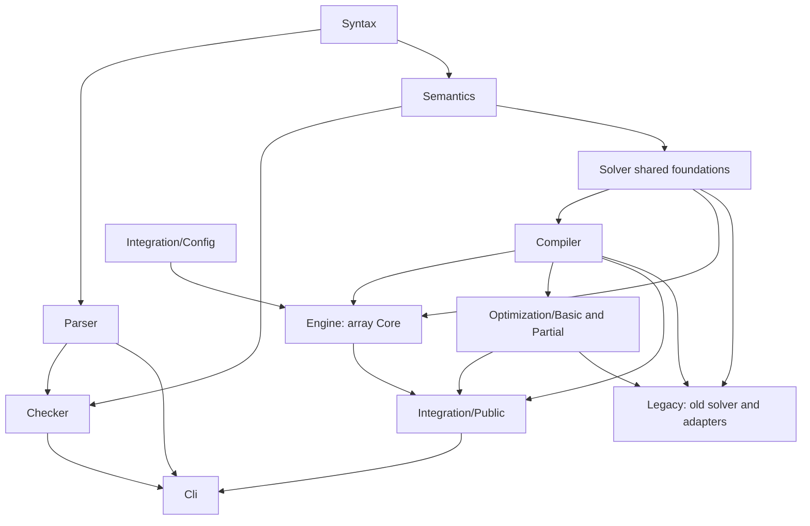

# LeanFzn code and proof structure

The public API uses the Core engine. Actual imports and
`lakefile.toml` are authoritative. [README.md](README.md) describes commands.

## Public dependency graph



The public CLI, Core engine, shared foundations and `Integration/` have no
imports of `LeanFzn.Legacy`. `LeanFzn.lean` and `Integration.lean` expose the
Core-only API. The boundary audit verifies these properties transitively.
It masks nested comments and strings, so an import immediately after `-/`
cannot evade the check. It also rejects missing project imports and cycles.

**Core engine** means `Engine/`. **Shared foundations** means `Solver/Core/`
and the retained `Solver/Propagation/` modules. Those foundations contain
problems, finite domains, constraint/literal semantics and proof infrastructure;
they are not a second public engine. Historical executable helper definitions
still appear in some shared reference/proof modules and need further extraction
before their corresponding old definitions can be deleted. The public drivers
never call the old search implementations.

## Reading paths

| Task | Start here |
| --- | --- |
| Parsing | `Syntax/AST` → `Parser/{Lexer,Grammar,Parser}` → `Parser/Proofs/` |
| Solution acceptance | `Semantics/{Model,Evaluation}` → `Checker/Runtime/` → `Checker/Proofs/` |
| Public solve | `Cli/Main` → `Integration/Public/Driver` → `Public/Solve` or `Public/{Optimize,Seed}` |
| Core runtime | `Engine/Types` → `Dom`, `Lit`, `Trail` → `Prop`, `Clauses`, `Queue/Run` → `Analyze`, `Reduce`, `Search` |
| Source correspondence | `Compiler/{Domain,Extract,Compile,Normalize,Fragment,LiteralFold,SetIn,SetShape,SetExpand,Bounds}` → `Compiler/Proofs/{Exact,Normalize,Fragment,LiteralFold,SetIn,SetShape,SetShapeWF,SetExpand,Bounds,Objective}` |
| TSP rank evidence | `Compiler/RankCircuit` → `Engine/Proofs/RankCircuit` → `Tests/Compiler/RankCircuitTest` |
| Generic optimization | `Integration/Optimization/Basic` → `Optimization/Partial` → `Public/Optimize` |
| Historical solver | Explicit `Legacy/Solver/{UIP,Chronological}` and `Legacy/Integration/` imports |

Paths are relative to `LeanFzn/` and omit `.lean`.

## Compiler pipeline

`compileModelFull m` runs five certified stages in order. `normalizeFull`
performs parameter/fragment expansion, the literal folds and constant-set
restriction (`Compiler/{Fragment,LiteralFold,SetIn,Normalize}`).
`shapeExpandModel` (in `Compiler/SetShape.lean`) rewrites the finite set
shapes `set_in_reif(x,S,b)` and `set_in(x,S)` with a variable integer
element, `set_card(S,k)` for a declared set `S`, `set_union` over
declared/literal finite sets, `set_intersect` over declared/literal finite
sets, and `array_var_set_element(i,[S…],T)` over an
explicit set array into fresh scalar auxiliaries: membership and equality
bits, Boolean conjunctions, `bool2int` aliases, linked by `bool_clause` rows,
one `bool_or` (union) or `bool_and` (intersection) row per universe value, or
one `array_var_bool_element` row per
value of the element/target universe. The shape pass and the set passes use
precomputed hash-set name tables (`ShapeState.maxLen`, `setNameSet`,
`setInSubjectNames`) and bounded fresh-name allocation so their cost is
linear on the multi-million-constraint warehouse models; the twins are proved
pointwise equal to the scanning specifications. The shape state also caches
auxiliaries by `ShapeKind` (`ShapeState.freshAux`), so repeated `x = v`,
`v ∈ S` and const-false requests share one auxiliary; `CacheOk`/`DefHolds`
prove that a hit names an auxiliary already present with exactly the requested
kind and type, and that its defining constraint still holds. `setExpandModel` (in
`Compiler/SetExpand.lean`) then replaces
every bounded scalar set variable by one fresh Boolean per universe value,
rewrites the supported `set_in`/`set_in_reif` literal-membership shapes, and
rejects any surviving reference to a removed set name; `setStore` rebuilds the
source set values from those Booleans. `boundsModel` (in
`Compiler/Bounds.lean`) then replaces every bare `var int`
with an interval replayed by a verified checker from a case-split, forced-branch
or linear-row certificate; a variable without a derivation returns `none`, and
the front door reports the honest unsupported error. Only checked entries are
used, and the recognizer's arithmetic is never trusted. `compileModel` finally
builds the finite-domain problem. `compileModelOpt` reaches the same path
through `compileModelFull (satisfyPart m)`, so the objective variable needs no
special bound case. The two-direction equivalence and well-formedness
preservation of the whole pipeline are in
`Compiler/Proofs/{Normalize,SetShape,SetShapeWF,SetExpand,Bounds}`.

The TSP rank checker is deliberately outside `compileModelFull`.
`Compiler/RankCircuit.lean` recognizes the Gecode `circuit` decomposition and
checks a certificate for the rank recurrence; `Engine/Proofs/RankCircuit.lean`
proves the generated 2-cycle clauses entailed. The default engine does not
register these clauses, and `Engine.Search` does not import the proof
module. `tests_rank_circuit` keeps the checker, the entailment theorem and the
false-ground UNSAT case as offline evidence.

## Core-only public APIs

```text
Integration/
  Config/         Types, Validate, Parse, Annotations
  Emit/           Basic, Model
  Optimization/   Basic, Partial
  Public/         Solve, Optimize, Seed, Driver, Preprocess, Lns, PhaseStats
```

Declarations for the new public solver live in `LeanFzn.Core`. Shared generic
optimization, rendering and configuration declarations remain in
`LeanFzn.Integration`. Old solver declarations keep their original namespaces
but require explicit `LeanFzn.Legacy...` imports. This preserves their theorem
statements without making the old execution contract part of the public API.

| Module | Contract |
| --- | --- |
| `Public/Solve` | `solveCompiled` maps Core `gaveUp` to `SearchResult.unknown`. `solveModel` compiles and transfers SAT/UNSAT to source stores. The stats twin performs the same single Core run. |
| `Public/Optimize` | Raw Core SAT/UNSAT is sound; give-up becomes an incomplete round. Linear optimization reuses generic branch-and-bound and exact streaming proofs. |
| `Public/Preprocess` | Applies the policy from `Compiler/Preprocess` before Core search and transports results through the proved acceptance equivalence. |
| `Public/Lns` | Uses bounded neighborhood searches to propose improving incumbents; only the unrestricted bound search can certify completion. Depends on `Public/Optimize`. |
| `Public/Seed` | Carries the certified clause database across stronger bounds using Engine.Incremental. Its invariant and streaming correspondence cover incomplete runs; no legacy fallback or unconditional completion theorem is used. |
| `Public/Driver` | Validates Core-only options, prints valid incumbents immediately, uses exit 4 for unknown/incomplete, and emits terminal markers only on certified completion. For `--threads=N` it runs independent certified workers over the four measured strategies, sharing only the parsed model and a mutex-guarded incumbent/proof state; an optimization proof is reported only when its optimum equals the best checked printed incumbent, while a satisfaction run reports the first completed verdict after checking a SAT witness. |
| `Public/PhaseStats` | Dev-only `--phase-stats` observation layer: it re-runs the same compiler composition and the same `initState`/`coreSolveFrom` calls as the certified entries, separated by stderr timestamps and `/proc/self/status` reads. It changes no verdict, solution or counter and is not on the ordinary path. |
| `Config/Parse` | `parseCoreSolveFlags` disables implicit legacy routing and rejects the kernel engine. The older compatibility parser is used only by explicit legacy APIs. |
| `Emit/Model` | Source-store rendering extracted from old source solving, with no backend dependency. |

`Solver/Core` still defines the shared compact `Dom`; Engine defines its own
array-oriented `DomC`. List-based mathematical enumeration and front-end lists
are retained. Core-only execution does not require rewriting those mathematical
interfaces as arrays.

## Certification and incompleteness

Every Core clause carries an erased `Entailed` proof through `EClause`.
Propagators and resolution construct certified clauses; a satisfying assignment
is checked by `fitsB && accepts`; UNSAT follows from an entailed empty clause.
`Engine/Search.coreSolve_sat` and `coreSolve_unsat` remain unchanged.

The public `solveCompiled_sat`/`_unsat` and
`solveModel_sat_correct`/`_unsat_correct` transport those claims to source
models. Core's fuel-bounded search always returns computationally, but may
return `gaveUp`. The public API intentionally makes no claim that every accepted
finite input receives SAT/UNSAT. Search limits and internal analysis failures
can produce give-up results.

`Optimization/Basic` preserves the existing `CertSolver`, generic loops,
termination measure, solution/optimality theorems and streaming specifications.
The chronological instance has moved to
`Legacy/Integration/Optimization/Chronological`. Basic now imports compiler
correspondence and shared domain lemmas directly, rather than old source solving.

`Optimization/Partial` introduces `PartialCertSolver`: SAT/UNSAT soundness
without a promise to decide every run. Its adapter uses the existing generic
interface's false completeness gate explicitly. That gate is a proof-side
optional guarantee, not a runtime admission test: the optimizer runs, retains
incumbents when a round fails, and proves optimality/UNSAT only when complete.
No old generic theorem has been weakened. The old unconditional completion
proofs remain attached to the preserved legacy definitions.

## Engine code and proofs

| Modules | Responsibility |
| --- | --- |
| `Bits` | Word-level set-bit scans, their native twins and equality proofs; depends only on Lean core and supports the engine domain/literal representations. |
| `Types`, `Dom`, `Proofs/Dom` | State, literals, `DomC` operations and their domain laws |
| `Lit`, `Trail`, `Clauses` | Denotation, entailment/resolution, assignments, restoration and watched clauses |
| `Prop`, `Props/` | Generic and specialized certified propagators. `Props/BoolExt` carries two support plans for Boolean rows: duplicate-free rows keep the original plan, and rows with a repeated operand slot enumerate only distinct slots, expand the value vector positionally to evaluate the relation and prune each distinct slot once; `boolSupportDupPropWith` and its choice wrappers are proved sound. |
| `Queue/{Types,Worklist,Apply,Run}` | Invariant specifications, event registration, pending prunings and fixpoint execution |
| `Proofs/Queue/{History,Invariants,Bookkeeping,Soundness}` | Preservation and propagation soundness |
| `Analyze`, `Reduce`, `Search` | Conflict analysis, clause reduction, variable/value policies, restarts and search; `Proofs/Queue/Root` supplies the root-entailment certificate used to erase level-zero literals from learned clauses, and learned clauses retain packed-literal intern hints (`CItem.pidx`) that `LitTable.internPacks` revalidates before reuse |
| `Incremental` | Certified database transport and seeded Core search across objective bounds |

Order propagators have `Bounds`, `Compare`, `Bridge`, `ReifiedReasons` and
`Reified` modules. Extended linear propagators have `Bounds`, `Plans`,
`Reified` and `Contracts`. Constructor prerequisites remain near the code that
needs them. Separating every entailment lemma into downstream proof files would
introduce backwards dependencies.

Parser, Checker and Compiler have explicit proof trees. Checker runtime and
correctness modules have separate umbrella imports. Semantics, some Engine
modules and the new seeded optimizer still mix executable definitions and
proofs; absence of a `Proofs/` folder does not imply absence of verification.

## Preserved legacy layer

`Legacy/` contains the old UIP and chronological implementations, their
exclusive propagation machinery, reference strategies, integration adapters,
old option drivers and historical Core-to-kernel fallback wrappers. The move
preserves mathematical declaration names and certified theorem statements.
Old imports were migrated explicitly; there are no active compatibility shims
outside Legacy that pull the old solver into the production graph.

Build the historical implementation with `lake build LeanFzn.Legacy`. The old
`LeanFzn.Solver.UIP` and `LeanFzn.Solver.Chronological` Lake target names remain
explicit development build aliases for the relocated modules. Existing legacy
regression tests and theorem-profile queries now import the relocated modules.
`tests_core_spike --engine=kernel` is a development comparison tool, not public
CLI routing.

Removing Legacy entirely is later work: identify shared proof/reference
helpers still needed by compiler/propagator correctness, preserve useful test
oracles, and then delete old algorithms and their historical theorems together.
No list-based completeness fallback is used to hide missing Core coverage now.

## Validation and maintenance

`Tests/` mirrors `LeanFzn/`: Parser, Semantics, Checker, Compiler, Engine and
Integration. Engine propagator tests are under `Tests/Engine/Props/`; public
optimizer/driver tests are under `Tests/Integration/Public/`. `Tests/Cli/`
contains subprocess CLI tests, `Tests/Architecture/` checks import boundaries,
and `Tests/Audits/` checks benchmark result classification. Shared FlatZinc
regressions live in `Tests/Fixtures/Solver/`.

The source audit masks nested comments and strings before rejecting active
`sorry`, `admit` or user axiom declarations, avoiding the old CI grep's false
positives on documentation.

Historical integration and list-solver tests live under
`Tests/Legacy/{Integration,Solver/Chronological,Solver/Propagation,Solver/UIP}`.
Retained old profiling tools live in `Tests/Legacy/Benchmarks/`. The differential
comparison tool is `Tests/Legacy/Integration/CoreDifferential.lean` because it
deliberately imports both engines. Native executable target names remain stable.

The Lake `Tests` library contains current tests only; `Tests.Legacy` is explicit.
The boundary audit also checks test imports, preventing current tests from
depending on Legacy directly or through historical test helpers. Details and
commands are in [Tests/README.md](Tests/README.md).

`tests_core_only` checks Core defaults, option rejection, SAT/UNSAT,
sparse-domain solving and unknown on zero fuel, linear and seeded min/max, clause reuse,
independent checker acceptance and retention of a streamed incumbent when a
later round is incomplete. `Tests/Cli/test_solve.py` checks exit codes,
markers, statistics and witness text. `Tests/Architecture/test_boundaries.py`
regresses nested-comment import scanning, strings, missing modules and cycles.

The full gate builds public and Legacy code explicitly, runs the registered
executables and both regression suites, audits theorem axioms and imports,
compares Core against the explicit legacy development oracle, fuzzes 3,000
instances and runs the quick performance suite. Historical gate and benchmark
records describe their source snapshots; they do not establish current Core-only
decision coverage. Record new measurements with their own source snapshot and
budget.

Benchmark reports distinguish completed mathematical agreement from explicit
incomplete allowances, when a manifest declares one. The nonunit-jump fixture
is expected to complete with UNSAT and has no incomplete allowance. Unknown
and incomplete-with-incumbent (exit 4) are separate outcomes, while false
terminal markers are errors. The quick gate requires every case either to
complete correctly or match its explicit incomplete allowance, with every
witness checked.

Gate logs and generated benchmark reports belong under ignored `tmp/`; input
manifests, regression fixtures and audit programs remain in the repository.
