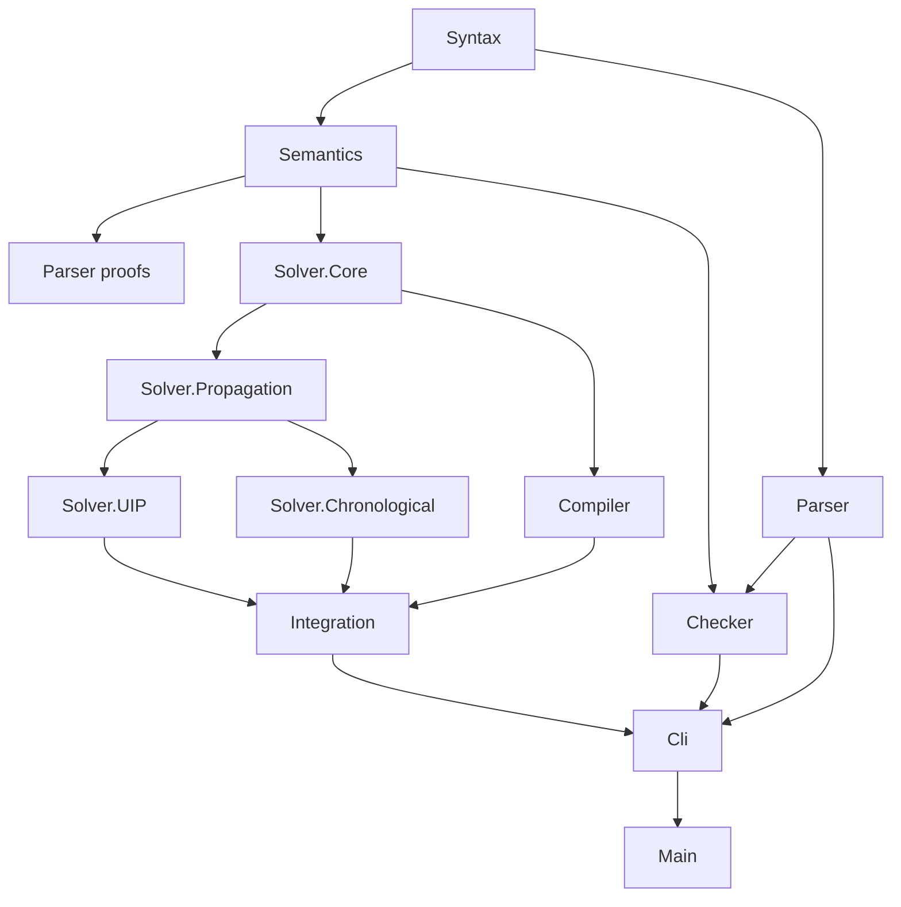

# LeanFzn component dependencies

The module and declaration hierarchy separates parsing, external solution
checking, compilation and the two search strategies. Internal modules use narrow
imports; LeanFzn.lean is an optional full-stack umbrella.

- Syntax owns AST types. Their extension methods remain in the owning AST type
  namespaces where Lean field notation requires it, although implementation and
  proof files reside in Parser/Semantics.
- Parser owns lexer, grammar, parser, pretty printer and soundness/completeness.
- Semantics owns stores, model meanings, standard/global predicate interpretation,
  shared evaluation and value-equality lemmas. It imports neither Checker nor
  either solver. Checker owns solution syntax, store completion, checking and
  verified executable twins.
- Compiler owns slot/domain extraction, constraint compilation, aux expansion
  and exactness proofs. It imports shared domain constraints but no strategy or
  checker. Reference search correctness is composed in Integration.Reference.
- Solver.Core owns representation-neutral problem/assignment semantics.
  Propagation owns clause/trail types, finite-frame semantics, propagators,
  explanation/refinement contracts and reusable proof primitives.
- Chronological owns Pruned, AnalysisDriver and the current solve entry and proofs.
  Its analysis-named driver prunes pending frames using learned clauses; it is
  still the current public chronological strategy, not the UIP scheduler.
- UIP owns Scheduler/Supported modules, pending/checkpoint/log/restoration proofs,
  pool/rank proofs and conditional whole-run certification. CompiledScheduler and
  CompiledSearch are strategy-local premise adapters, not public source routing.
- Reference owns exhaustive search and historical diagnostic loops. Shared
  explanation proofs use some diagnostic loop facts; Reference imports neither
  public strategy. No code is duplicated between strategies.
- Integration owns source theorem composition, chronological domain wrappers,
  certified solve/fallback policies and diagnostic source proof adapters.
  CLI composes parse/check/solve I/O; Main is only the executable entry wrapper.

Each component is registered as a separate Lake library with its root and
submodules. Tests are grouped into Parser, Checker, Semantics, Propagation,
Chronological, UIP and Integration. Compiler/source correspondence assertions
are exercised by Integration.Solver. Existing executable target names remain stable.

`audits/check_module_boundaries.py` checks transitive forbidden imports and
cycles. Current source imports are authoritative.
All continuation instructions and open obligations remain exclusively in PLAN.md.
